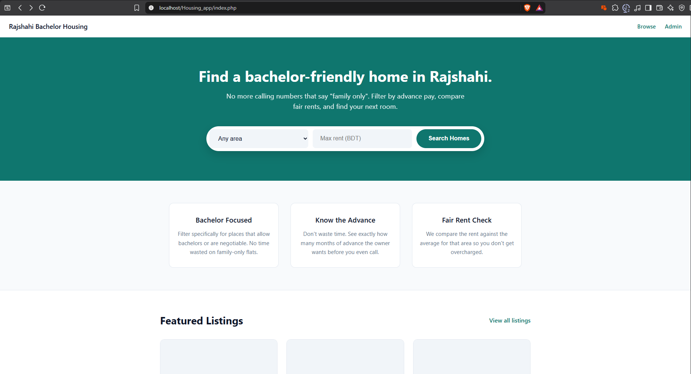
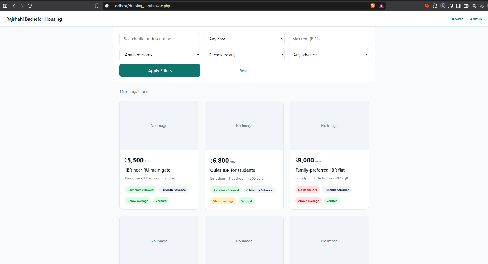

# Bachelor Housing

A web application built to solve the hassle of finding bachelor-friendly flats in Rajshahi. 

## The Problem
Bachelors waste weeks calling numbers that turn out to be "family only" or demand 3 months of advance. Mainstream listing sites don't let you filter for these things.

## Features
- **Bachelor Focused:** Filter specifically for flats that allow bachelors.
- **Advance Pay Filter:** See exactly how many months of advance the owner wants.
- **Fair Rent Check:** Automatically compares a listing's rent against the average for that area to warn you if it's overpriced.
- **Room-by-Room Gallery:** Owners can upload multiple photos for the bedroom, kitchen, living room, and bathroom.
- **Google Maps Integration:** Direct link to the exact location of the flat.
- **Admin Panel:** Add new listings, upload photos, and verify if a listing is still available.

## Tech Stack
- **Backend:** PHP (No frameworks, pure PHP)
- **Frontend:** HTML, CSS, Vanilla JavaScript
- **Database:** JSON (Flat file, easy to migrate to MySQL later)

## How to Run Locally
1. Install [XAMPP](https://www.apachefriends.org/).
2. Clone this repo into your `C:\xampp\htdocs\` folder.
3. Start Apache in the XAMPP Control Panel.
4. Go to `http://localhost/rajshahi-housing-app/` in your browser.

## Admin Login
Default password is set in `config.php` (Default: `rajshahi123`).

---
*Note: This is a portfolio project. All sample listings use fake phone numbers.*
